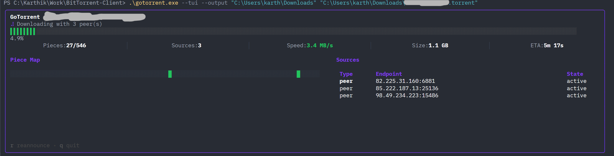
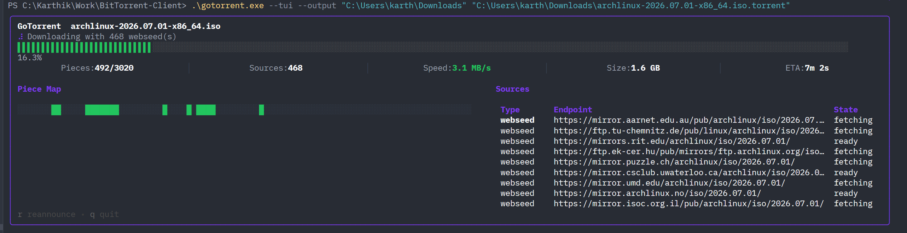
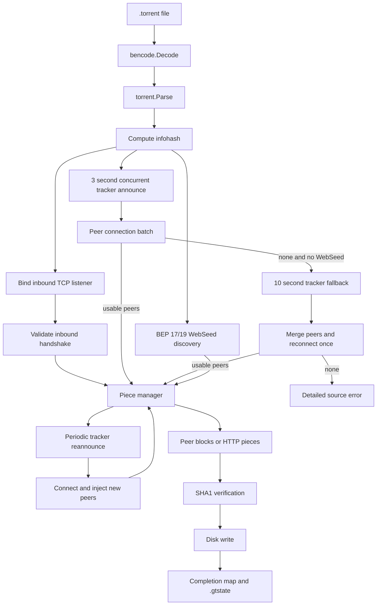

# GoTorrent

GoTorrent is a BitTorrent client written in Go. It implements torrent parsing, tracker announces, peer wire handling, piece scheduling, resume state, and HTTP WebSeed downloads. The TUI uses [Bubble Tea](https://github.com/charmbracelet/bubbletea) for the terminal interface.




## Features

- `.torrent` parsing with raw `info` dict hashing
- concurrent HTTP and UDP tracker discovery with bounded fallback
- periodic tracker reannounce using tracker-provided intervals
- TCP peer handshake, connection diagnostics, and BitTorrent wire protocol
- inbound TCP peer acceptance on the tracker-announced listen port
- rarest-first piece selection with endgame fallback
- SHA1 verification and disk writes
- resume state saved as `.gtstate`
- WebSeed support via BEP 17 and BEP 19
- responsive Bubble Tea/Bubbles TUI with exact progress, speed, ETA, and unified peer/WebSeed sources
- manual tracker reannounce from the TUI with a tracker-friendly cooldown
- bounded peer-wire frames, upload requests, and filesystem-safe torrent paths

## Layout

```text
cmd/gotorrent/        CLI entrypoint
internal/bencode/     Bencode encoder and decoder
internal/torrent/     Torrent metainfo parsing and infohash logic
internal/tracker/     Concurrent HTTP/UDP announces and peer discovery
internal/peer/        Handshake, wire messages, and peer connections
internal/piece/       Scheduling, verification, writer, and resume state
internal/session/     Periodic discovery and live peer injection
internal/webseed/     HTTP WebSeed sources
internal/tui/         Bubble Tea UI
```

## Build

```bash
go build -o gotorrent ./cmd/gotorrent
```

## Run

```bash
# CLI
./gotorrent --output /downloads path/to/file.torrent

# TUI
./gotorrent --tui --output /downloads path/to/file.torrent

# Custom inbound listen port
./gotorrent --port 6881 --output /downloads path/to/file.torrent

# Let the operating system choose an available listen port
./gotorrent --port 0 --output /downloads path/to/file.torrent
```

## Test

```bash
go test ./...
go test ./... -race -count=1
```

## Architecture



Tracker announces return candidate addresses, not guaranteed connections. GoTorrent first announces to every tracker concurrently with a three-second budget. If no peer connects and no WebSeed is available, it performs one ten-second fallback announce, merges and deduplicates both peer sets, and attempts one final connection batch.

Before announcing, GoTorrent binds the configured TCP listen port and reports the actual bound port to trackers. Inbound handshakes have a fixed deadline and bounded concurrency; connections with the wrong info hash, the local peer ID, or a duplicate peer identity or endpoint are rejected. Accepted inbound peers enter the same piece manager as outbound peers and can join a download that is waiting without any usable startup connection.

During a download, GoTorrent reannounces using the tracker-provided interval. Periodic requests include current verified `downloaded` and `left` values, omit the startup event, and use a ten-second request timeout. Newly returned addresses are deduplicated against previously attempted peers; successful connections are added to the active piece manager without restarting the download. Failed periodic rounds retry after five minutes.

In TUI mode, press `r` to request an immediate reannounce. Manual, startup, and periodic attempts share a 60-second cooldown; the status line reports the remaining wait when a request is too early. Press `q` to cancel cleanly and persist verified progress.

Resume state is stored beside the payload as `<torrent-name>.<12-character-infohash>.gtstate`. Every piece marked complete is rehashed from disk before it is trusted, so a stale state file cannot make a missing or corrupt payload appear complete. Legacy `<torrent-name>.gtstate` files are verified and migrated automatically. Separate GoTorrent processes are safe when their torrents resolve to different payload directories, whether or not those directories share a parent; concurrent writes to the same payload directory are unsupported.

The client uses one peer ID for tracker announces and all handshakes. Once a peer connection starts, one writer goroutine serializes every outbound wire message.

Torrent metadata and peer messages are treated as untrusted input. Names and multi-file path components cannot select absolute or parent paths, file-length arithmetic is checked for overflow, peer message allocation is capped, fixed-shape payloads are validated, and upload requests cannot cross a verified piece boundary or exceed 16 KiB.

Progress and throughput are intentionally separate: verified piece bytes drive completion, while accepted peer and WebSeed payload bytes feed a rolling three-second speed calculation. Successfully served peer payload is tracked separately and included in subsequent tracker announces.

## Not Yet Supported

- DHT
- PEX
- magnet links
- BitTorrent v2
- uTP
- rate limiting

## License

MIT © 2026 Karthik Das

See [LICENSE.md](LICENSE.md) for the full text.
